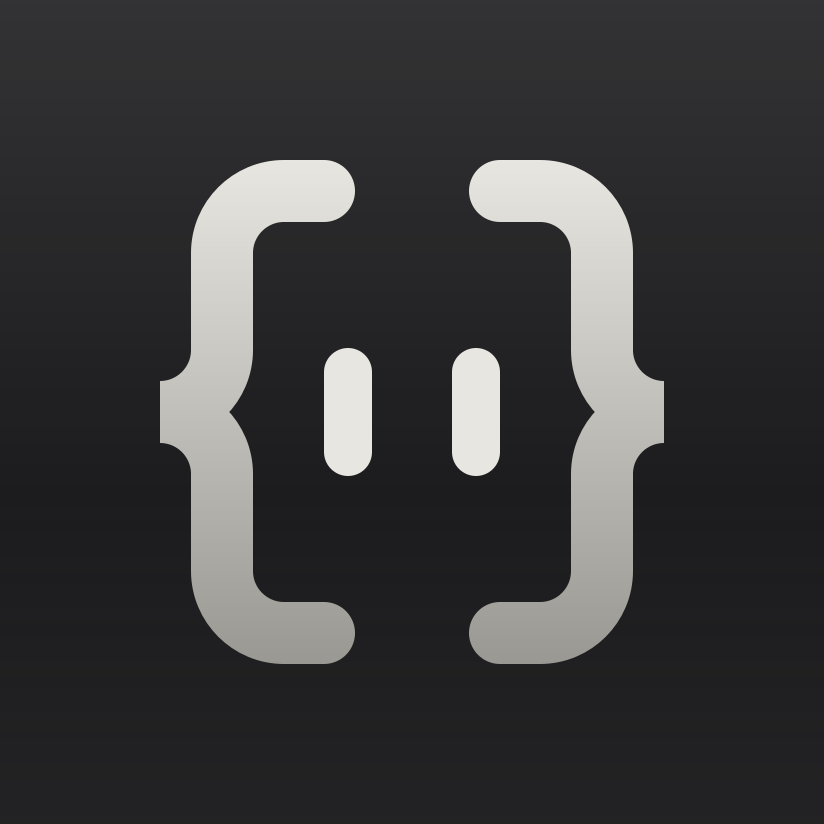
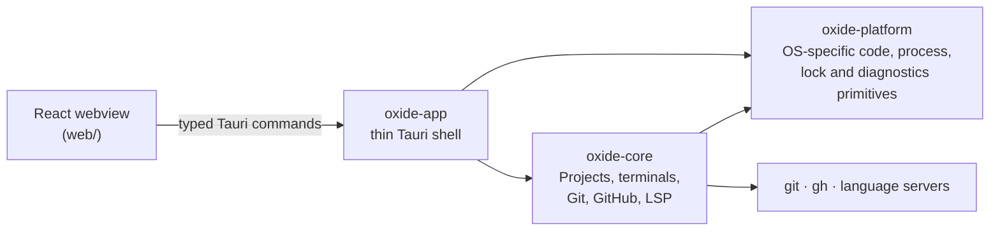

<p align="center">
  
</p>

<h1 align="center">Oxide</h1>

<p align="center">
  <strong>A terminal app that knows your GitHub Projects.</strong><br />
  Open a Project, open as many clean terminals as you like in its folder, and run whatever you want in them.
</p>

<p align="center">
  <a href="https://github.com/getoxide/oxide/actions/workflows/ci.yml"></a>
  <a href="LICENSE"></a>
  
  
  
</p>

<p align="center">
  <a href="#install">Install</a> ·
  <a href="#features">Features</a> ·
  <a href="#how-it-works">How it works</a> ·
  <a href="#build-from-source">Build from source</a> ·
  <a href="#faq">FAQ</a> ·
  <a href="CONTRIBUTING.md">Contributing</a>
</p>

<!-- The invisible site markers in this README delimit content that the Oxide website
     (getoxide/website) extracts during its content sync. Do not remove or rename a marker. -->

## What is Oxide?

<!-- site:definition -->

Oxide is a free, open-source desktop terminal app that knows your GitHub Projects: open a Project, open as many clean terminals as you like in its folder, and run whatever you want in them, with the Project's GitHub Issues, pull requests and files at hand.

<!-- /site:definition -->

Oxide does not know about agents. A terminal is a plain shell that Oxide does not interpret, so if you want an agent you type `claude`, `codex` or anything else in it, like any other command. No Oxide launch flags, prompts, statuses or permissions are involved ([ADR-0018](docs/adr/0018-projects-and-plain-terminals.md)).

> [!NOTE]
> **Oxide is pre-release software.** Official builds target **macOS on Apple Silicon**, **Windows** (x64 and arm64) and **Linux** (x64 and arm64). Expect rough edges and breaking changes between versions.

## Features

<!-- site:features -->

### Projects and plain terminals

- **Open Projects.** The sidebar lists the Projects you opened and, under each, its terminals. A **New terminal** control on a Project opens a fresh shell already in its folder. Close a Project and its terminals end with it.
- **Many terminals.** Run a server, an agent and a test watcher side by side. The selected terminal fills the centre; switching keeps each one's scrollback, working directory and running process.
- **Command blocks.** The Warp-like grouping of command, output and exit status.

### GitHub at hand

- **Issues.** List, read and create GitHub Issues for the Project, through the [GitHub CLI](https://cli.github.com).
- **Pull requests.** List, read, create, review and merge pull requests, or turn on auto-merge while checks run.
- **Files.** Browse the Project's folder in the right dock and open a file in the Code workspace, the built-in editor that takes the centre in place of the terminals: Monaco with language servers for Rust, TypeScript/JavaScript, Python and C/C++, installed on first use, only when you press Install.

<!-- /site:features -->

## Install

Download the installer for your platform from [GitHub Releases](https://github.com/getoxide/oxide/releases):

<!-- site:install -->

| Platform | File | Notes |
| --- | --- | --- |
| macOS (Apple Silicon) | `Oxide_<version>_macos_arm64.dmg` | Drag `Oxide.app` into `/Applications`. |
| Windows 10/11 (x64) | `Oxide_<version>_windows_x64.exe` | NSIS installer. |
| Windows 11 (arm64) | `Oxide_<version>_windows_arm64.exe` | NSIS installer. |
| Linux (x64) | `Oxide_<version>_linux_x64.AppImage`, `.deb` or `.rpm` | |
| Linux (arm64) | `Oxide_<version>_linux_arm64.AppImage`, `.deb` or `.rpm` | |

<!-- /site:install -->

Until the first stable release is published, [build from source](#build-from-source).

### Requirements

`git` is required. The [GitHub CLI](https://cli.github.com) (`gh`, logged in) is optional and enables the pull request and Issues features. Anything else you run in a terminal, an agent CLI included, is installed and logged in the way it is outside Oxide.

### Updates

Oxide has no in-app updater: the Settings page is empty for now. To update, download the newer installer from [GitHub Releases](https://github.com/getoxide/oxide/releases) and install it over the old one.

### Verifying a download

Every release lists the SHA-256 checksums in its release notes and attaches a [build-provenance attestation](https://docs.github.com/en/actions/security-guides/using-artifact-attestations-to-establish-provenance-for-builds) for each installer, which ties it to the exact workflow run and commit that built it:

```sh
shasum -a 256 Oxide_<version>_macos_arm64.dmg   # macOS; compare with the release notes
gh attestation verify Oxide_<version>_macos_arm64.dmg --repo getoxide/oxide
```

On Windows, compare `(Get-FileHash .\Oxide_<version>_windows_x64.exe).Hash` with the release notes (`windows_arm64.exe` on Windows on Arm). On Linux, use `sha256sum Oxide_<version>_linux_x64.AppImage`.

### Opening an unsigned build

Each release says whether it is code-signed on your platform.

**macOS.** Oxide does not join the Apple Developer Program, so its releases are **ad-hoc signed and not notarized**, and Gatekeeper blocks them on first launch. To open one:

1. Drag `Oxide.app` from the `.dmg` into `/Applications` and try to open it once.
2. Open **System Settings → Privacy & Security**, scroll to the message about Oxide, and click **Open Anyway**.

Alternatively, remove the quarantine flag from the terminal: `xattr -dr com.apple.quarantine /Applications/Oxide.app`.

**Windows.** The installer is **not Authenticode-signed**, so SmartScreen may warn on first run. Choose **More info → Run anyway** after verifying the download as above.

**Linux.** The packages are **not signed with a distribution key**; verify them with the checksums and attestations above. Make an AppImage executable (`chmod +x Oxide_<version>_linux_x64.AppImage`) and run it, or install the package with `sudo apt install ./Oxide_<version>_linux_x64.deb` or `sudo dnf install ./Oxide_<version>_linux_x64.rpm`. Oxide needs WebKitGTK 4.1 (`libwebkit2gtk-4.1`), which any distribution from the last few years ships; the packages are built on Ubuntu 22.04.

## Quick start

<!-- site:quick-start -->

1. Launch Oxide and click **Open a Project**: pick a folder, create one with `git init`, or clone a repository (from a URL, or one of your GitHub repositories through `gh`).
2. Click **New terminal** on the Project. You get a shell in its folder. Run whatever you want, `claude` or `codex` included.
3. Open as many terminals as you like and switch between them in the sidebar.
4. Use the right dock for the Project's **Files**, **Issues** and **Pull request**.

<!-- /site:quick-start -->

## How it works



- `crates/oxide-platform`: the only crate with OS-specific code, plus the process, lock and diagnostics primitives ([ADR-0019](docs/adr/0019-platform-layer.md)).
- `crates/oxide-core`: Projects, SQLite storage, terminals and their shells, files, Git, GitHub and language servers. It knows nothing about Tauri.
- `crates/oxide-app`: the thin Tauri shell that exposes Core to the webview.
- `web/`: the React frontend, grouped by area under `web/src` (`projects`, `terminal`, `editor`, `issues`, `pull-requests`, `settings`, `shared`, `styles`).
- `assets/`: the app icon masters and the palette ([assets/README.md](assets/README.md)).

- **Core owns files and processes.** The webview gets no filesystem or shell permission. Every action goes through a typed Tauri command generated with [tauri-specta](https://github.com/specta-rs/tauri-specta), and every shell is a process Core owns ([ADR-0016](docs/adr/0016-security-boundaries.md)).
- **A terminal is a plain shell.** Oxide does not interpret what runs in it ([ADR-0018](docs/adr/0018-projects-and-plain-terminals.md)).

The domain language (Project, Terminal, Surface…) is defined in [GLOSSARY.md](GLOSSARY.md), and every architecture decision is recorded in [docs/adr/](docs/adr/).

## Build from source

### macOS (Apple Silicon)

- Xcode Command Line Tools (`xcode-select --install`)
- [rustup](https://rustup.rs). The toolchain is pinned in [`rust-toolchain.toml`](rust-toolchain.toml) and installed automatically.
- Node.js 22 and pnpm via [Corepack](https://nodejs.org/api/corepack.html) (`corepack enable`). The pnpm version is pinned in `web/package.json`.

```sh
git clone https://github.com/getoxide/oxide.git
cd oxide
pnpm --dir web install

# Run the app in development mode (hot-reloading frontend), from the repository root.
# The dev config names it "Oxide Dev" and gives it the icon with the amber band,
# so it is never mistaken for an installed release.
web/node_modules/.bin/tauri dev --config crates/oxide-app/tauri.dev.conf.json

# Build the app bundle and .dmg into target/release/bundle/
pnpm --dir web build:app
```

The Tauri CLI must run from the repository root: that is where it finds `crates/oxide-app/tauri.conf.json`.

### Windows (x64 and arm64)

- Windows 10 (version 1803 or later) or Windows 11. These include the [WebView2 Runtime](https://developer.microsoft.com/microsoft-edge/webview2/); on older or customized installations, install the Evergreen Runtime manually.
- [Microsoft C++ Build Tools](https://visualstudio.microsoft.com/visual-cpp-build-tools/) with the **Desktop development with C++** workload.
- [rustup](https://rustup.rs), Node.js 22 and pnpm through Corepack (`corepack enable`), as on macOS.

In PowerShell:

```powershell
git clone https://github.com/getoxide/oxide.git
Set-Location oxide
pnpm --dir web install

# Run the app in development mode (hot-reloading frontend).
.\web\node_modules\.bin\tauri.cmd dev

# Build a Windows installer (NSIS .exe) into target\release\bundle\nsis\.
.\web\node_modules\.bin\tauri.cmd build --bundles nsis
```

To build an MSI instead, use `--bundles msi`; if that fails with a `light.exe` error, enable the **VBScript** optional Windows feature and try again. On Windows on Arm the same commands build a native arm64 installer; add the **ARM64 build tools** component to the Visual Studio workload.

### Linux (x64 and arm64)

- A recent distribution with WebKitGTK 4.1. On Debian or Ubuntu:

  ```sh
  sudo apt install build-essential curl file patchelf pkg-config xdg-utils \
    libwebkit2gtk-4.1-dev libayatana-appindicator3-dev librsvg2-dev libssl-dev libxdo-dev
  ```

  Other distributions need the equivalent packages (see Tauri's [prerequisites](https://v2.tauri.app/start/prerequisites/#linux)).
- [rustup](https://rustup.rs), Node.js 22 and pnpm through Corepack (`corepack enable`), as on macOS.

```sh
git clone https://github.com/getoxide/oxide.git
cd oxide
pnpm --dir web install

# Run the app in development mode (hot-reloading frontend).
web/node_modules/.bin/tauri dev

# Build an AppImage, .deb and .rpm into target/release/bundle/.
web/node_modules/.bin/tauri build --bundles appimage,deb,rpm
```

### Tests and checks

```sh
node tools/check.mjs        # everything the CI pull request lanes run on this OS
node tools/check.mjs fast   # rustfmt, ESLint and TypeScript, in seconds
```

The Rust tests run with [cargo-nextest](https://nexte.st) (`cargo install --locked cargo-nextest`).

[docs/devops.md](docs/devops.md) lists every check CI runs, why it exists and its local equivalent.

## FAQ

<!-- site:faq -->

**What is Oxide?**
Oxide is a free, open-source desktop terminal app that knows your GitHub Projects: open a Project, open as many clean terminals as you like in its folder, and run whatever you want in them, with the Project's Issues, pull requests and files at hand.

Oxide is not a coding agent and does not drive one: a terminal is a plain shell. Oxide is not affiliated with Oxide Computer Company.

**Do I need an API key?**
No. Oxide has no account and no key. Whatever you run in a terminal uses its own login, exactly as it does anywhere else.

**Does Oxide send my code anywhere?**
Oxide has no telemetry and no server. It talks to GitHub only through your own `gh` login, when you open Issues or Pull request.

**Can I run Claude Code or Codex in it?**
Yes: type `claude` or `codex` in a terminal like any other command. Oxide adds nothing around it.

**Which platforms are supported?**
Official builds target macOS on Apple Silicon, Windows (x64 and arm64) and Linux (x64 and arm64, as an AppImage, `.deb` and `.rpm`). Linux is new, so expect more rough edges there than on macOS and Windows.

**Is it free?**
Yes. Oxide is open source under the [MIT License](LICENSE).

<!-- /site:faq -->

## Contributing

Contributions are welcome. Read [CONTRIBUTING.md](CONTRIBUTING.md) for the branch model, local checks and pull request conventions, and look for issues labelled [`good first issue`](https://github.com/getoxide/oxide/issues?q=is%3Aissue%20is%3Aopen%20label%3A%22good%20first%20issue%22) or [`help wanted`](https://github.com/getoxide/oxide/issues?q=is%3Aissue%20is%3Aopen%20label%3A%22help%20wanted%22).

- [GLOSSARY.md](GLOSSARY.md): the domain language
- [docs/adr/](docs/adr/): architecture decisions
- [docs/devops.md](docs/devops.md): CI, releases and the release runbook
- [AGENTS.md](AGENTS.md): instructions for coding agents working on Oxide
- [SUPPORT.md](SUPPORT.md): where to ask questions and report bugs

Please follow the [Code of Conduct](CODE_OF_CONDUCT.md). Report security vulnerabilities privately, as described in [SECURITY.md](SECURITY.md).

## License

Oxide is released under the [MIT License](LICENSE). Claude Code, Codex and Antigravity are trademarks of their respective owners; Oxide is an independent project, not affiliated with or endorsed by Anthropic, OpenAI or Google. It is also not affiliated with Oxide Computer Company.
