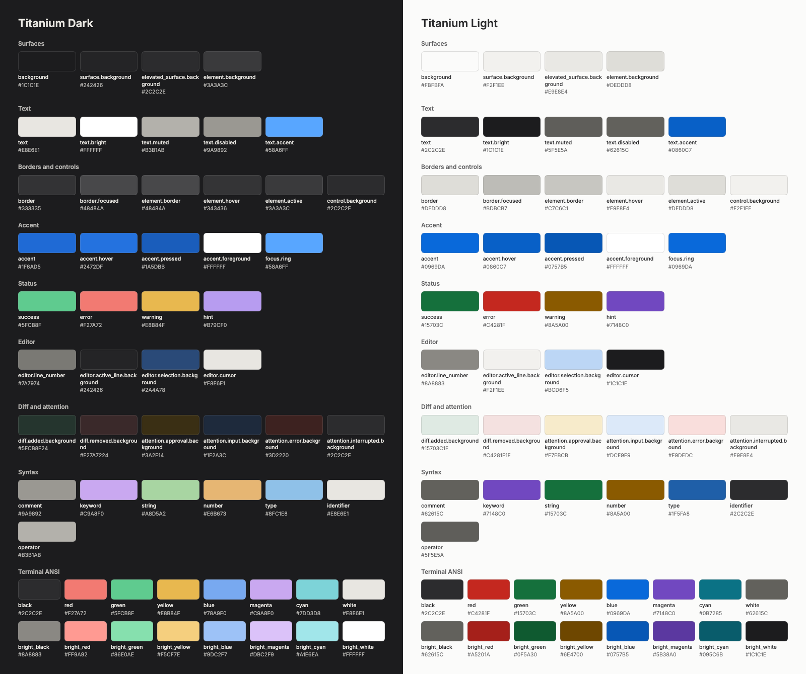

# Oxide brand

The **Braces** mark: a pair of curly braces with two text cursors as eyes. A block of code that looks back at you, for an app about seeing exactly what your coding agents changed.

The logo is always Titanium. Blue is the software's action colour and never appears in the logo.

## Logo files

All SVGs use fixed HEX colours and outlined shapes, so they need no fonts or CSS.

| File | Use |
| --- | --- |
| `oxide-mark.svg` | Mark on dark backgrounds, Titanium gradient. The primary version. |
| `oxide-mark-on-light.svg` | Mark on light backgrounds. |
| `oxide-mark-white.svg`, `oxide-mark-black.svg` | One-colour mark for print, embossing and system template images. |
| `oxide-logo.svg`, `oxide-logo-on-light.svg` | Horizontal mark and wordmark. The wordmark is Space Grotesk Medium, converted to outlines. |
| `oxide-app-icon.svg` | macOS app icon: 824 plate on the 1024 canvas, transparent margin, with `plate` and `glyph` layers. |
| `oxide-app-icon-windows.svg` | Same artwork cropped to fill the canvas, for Windows `.ico` and Linux. |
| `oxide-favicon.svg` | Heavier glyph for 48 px and below, where the standard mark loses its eyes. |
| `oxide-avatar.svg` | Opaque square for GitHub and social avatars, and Apple touch icons. |
| `oxide-social-preview.svg` | 1280×640 source of the GitHub social preview. |

Use the mark or app icon when the background is unknown: a transparent Titanium mark disappears on white.

Keep clear space around the mark of at least one eye height on every side. Do not recolour it with the accent, add effects, or set the wordmark in another typeface. Below 24 px, use `oxide-favicon.svg`.

## PNG exports

Rendered from the SVG masters with resvg.

| Folder | Sizes |
| --- | --- |
| `png/mark/`, `png/mark-on-light/`, `png/mark-white/`, `png/mark-black/` | 16, 32, 64, 128, 256, 512, 1024 |
| `png/logo/`, `png/logo-on-light/` | 285×96, 570×192, 1140×384 |
| `png/app-icon/` | 128, 256, 512, 1024 |
| `png/app-icon-windows/` | 256, 512, 1024 |
| `png/favicon/` | 16, 32, 48, 64 |
| `png/avatar/` | 180, 512, 1024 |
| `png/social-preview.png` | 1280×640, for Settings → General → Social preview |

## Colour

The **Titanium** palette has a dark and a light variant. Neutrals are slightly warm and come from the logo; blue marks actions, and the status colours carry information.

| Role | Dark | Light |
| --- | --- | --- |
| Background | `#1C1C1E` | `#FBFBFA` |
| Surface | `#242426` | `#F2F1EE` |
| Elevated surface | `#2C2C2E` | `#E9E8E4` |
| Element | `#3A3A3C` | `#DEDDD8` |
| Border | `#333335` | `#DEDDD8` |
| Control border | `#48484A` | `#C7C6C1` |
| Text | `#E8E6E1` | `#2C2C2E` |
| Bright text | `#FFFFFF` | `#1C1C1E` |
| Muted text | `#B3B1AB` | `#5F5E5A` |
| Faint text | `#9A9892` | `#62615C` |
| Accent | `#1F6AD5` | `#0969DA` |
| Accent hover | `#2472DF` | `#0860C7` |
| Accent pressed | `#1A5DBB` | `#0757B5` |
| Accent foreground | `#FFFFFF` | `#FFFFFF` |
| Link | `#58A6FF` | `#0860C7` |
| Focus ring | `#58A6FF` | `#0969DA` |
| Success | `#5FCB8F` | `#15703C` |
| Error | `#F27A72` | `#C4281F` |
| Warning | `#E8B84F` | `#8A5A00` |
| Hint | `#B79CF0` | `#7148C0` |

Text, status and syntax colours reach at least 4.5:1 on the background, surface and elevated surface. Terminal colours, except ANSI black, reach it on the terminal background.

| File | Contents |
| --- | --- |
| `palette/oxide-tokens.json` | Source of truth: every colour and the typography. |
| `palette/oxide-tokens.css` | The same colours as `--ox-*` custom properties, with `data-theme` for light. |
| `palette/oxide-titanium-theme.json` | Theme pack for Settings → Appearance, in the format of [docs/themes.md](../../../docs/themes.md). |
| `palette/oxide-palette.png` | Visual reference of the whole palette. |

## Typography

All typefaces are licensed under the SIL Open Font License 1.1.

| Where | Role | Typeface | Notes |
| --- | --- | --- | --- |
| Software | Interface | Inter | 13 px, Regular; line height 1.45 |
| Software | Chat | Inter | 14 px, Regular; line height 1.55 |
| Software | Editor and terminal | JetBrains Mono | 13 px, Regular; ligatures off |
| Website | Headings and wordmark | Space Grotesk | Medium; tracking −0.03 em |
| Website | Body | Inter | Regular |
| Website | Code | JetBrains Mono | Regular; ligatures off |

Space Grotesk stays out of the software: it is a display face, and the interface is dense small text.
